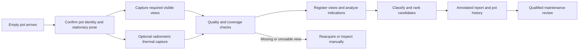

# Challenge submission: automated non-contact inspection of slag pots

**Submitted by:** Umair (`umairrrkhan`)  
**Date:** 11 October 2026  
**Project:** [tata-slag-pot-crack-detection](https://github.com/umairrrkhan/tata-slag-pot-crack-detection)

## Executive summary

We propose a shared inspection station for approximately 20 slag pots that combines high-resolution visible imaging, optional high-temperature radiometric thermal imaging, and local image analysis. Cameras and illumination are mounted on the inspection station; no sensor is attached to a slag pot. The station inspects empty pots on the return route, prioritizes recurring defect locations while retaining full-surface coverage, and produces annotated images, ranked crack indications, and a digital history for each pot.

A working CPU prototype accompanies this proposal. It detects crack-like surface indications, classifies their image orientation, incorporates recurring-location and thermal evidence into review ranking, and automatically creates Markdown/JSON reports and SQLite inspection records. Seventeen automated tests passed. On synthetic 1024×768 images, detection took a median of 115.04 ms and a 95th percentile of 125.23 ms across 20 warmed runs.

These results demonstrate software functionality and processing speed. Detection reliability on real slag pots at 500–700°C remains a pilot validation requirement. A production segmentation model, camera integration, and calibrated geometry are proposed next steps; they are not claimed as completed features.

## 1. Problem and design requirements

Thermal cycling, mechanical stress, and impact loading can create cracks in slag pots. Manual visual inspection can miss defects and produces inconsistent records. The proposed solution addresses non-contact detection, classification, reporting, and traceability in a hot, dusty steel plant environment.

| Challenge requirement | Proposed solution | Current deliverable |
|---|---|---|
| No sensors mounted on pots | Fixed cameras, lighting, and protected station equipment | Station engineering design |
| Crack detection and classification | Visible imaging with production segmentation; thermal corroboration | Runnable morphology baseline and orientation labels |
| Recurring crack locations | Prioritized high-resolution acquisition without excluding other areas | Configurable hotspot review bonus and full supplied ROI analysis |
| Inspection at 500–700°C or below | Rated protective housings, heat shielding, filtered lighting, high-temperature thermal range | Equipment requirements; hot-pot validation pending |
| Automated reporting and ranking | Annotated evidence, measurements, ranked indications, review status | Markdown/JSON reports and candidate ranking |
| Digital records for about 20 pots | Pot identification and inspection history | Indexed SQLite records by pot ID |
| Predictive failure detection desirable | Registered growth trends followed by validated hazard modeling | Roadmap; no failure prediction claim |

## 2. Proposed inspection architecture



The diagram describes the complete proposed station. The delivered software implements declared view completeness, contrast/clipping checks, image analysis, ranking, reporting, and history. Automatic identity verification, hardware triggering, pose registration, and reacquisition control require plant integration.

The existing handling system should present side, rim, lower-body, base, and accessible interior views as required by a geometry survey. Occluded critical areas require additional cameras or safe repositioning. One common station serves the fleet, avoiding instrumentation on every pot.

## 3. High-temperature imaging and resolution

Visible imaging is the primary modality because cracks are surface geometrical indications. Industrial cameras should use short exposures, controlled blue/green illumination, and matched filters, subject to trials on real hot surfaces. Rated cooled or purged housings, radiant heat shields, and protected optical windows are required. Standoff and heat load must be calculated from the installation geometry.

Thermal imaging supplies supporting evidence and must use a radiometric camera with a documented range beyond the expected 700°C surface temperature. Emissivity, reflections, oxide, deposits, and cooling gradients can all alter readings. Thermal contrast alone is insufficient to identify a crack, and absent thermal contrast must not suppress a visible candidate. The prototype accepts aligned Celsius arrays rather than colorized thermograms.

Camera selection begins with the smallest crack opening to be detected. A preliminary three-pixel sampling rule for a 0.5 mm opening implies at most 0.167 mm/pixel, or about 6,000 horizontal pixels across a 1 m field of view. This is a design calculation, not a demonstrated detection limit. The demo uses 0.5 mm/pixel and three-pixel synthetic lines, corresponding to 1.5 mm apparent width.

Curved surfaces require local geometric calibration. The prototype reports projected extent and average apparent width when scale is supplied. It does not measure crack depth, wall penetration, true curved crack length, or remaining structural strength.

## 4. Detection, classification, and optimization

The implemented baseline uses compiled NumPy/SciPy morphology to extract narrow dark and bright indications, then groups connected pixels and filters components using size, width, and elongation. Principal-axis geometry assigns horizontal, vertical, or oblique orientation in image coordinates. These categories support review; they are not metallurgical failure classifications.

Candidates are ranked using projected pixel extent, overlap with configured recurring locations, and optional local thermal contrast. Scores are explicit heuristics rather than calibrated confidence or failure probabilities. Full supplied regions remain eligible for detection, so hotspot prioritization does not exclude new locations.

For fixed filter sizes, image filtering and labeling have approximately linear processing cost in pixel count, and memory scales with input size. Component geometry is calculated within local bounding boxes. Input budgets of eight million pixels per view and 32 views per inspection limit workload. Larger production views require suitable acquisition tiling and reconciliation, which remain integration work.

For production, train a compact segmentation network on annotated plant images containing cracks and difficult negatives such as seams, scratches, scale, deposits, and repairs. Evaluate isolated, branched, and network indications if sufficient labeled examples exist. ONNX deployment and validated FP16/INT8 inference can improve throughput after confirming small-defect recall.

## 5. Reports, records, and maintenance workflow

Each inspection generates a unique directory containing an inspection Markdown report, structured JSON, and annotated PNGs. Records include pot ID, capture time, algorithm/configuration provenance, input hashes, candidates, ranking, supplied calibration, thermal evidence, and declared coverage. SQLite provides indexed per-pot history.

Missing required views or unusable images make an inspection incomplete. Other outputs request review, including when no candidates are found. Qualified maintenance personnel determine whether further inspection, suitable NDT, repair, or withdrawal from service is necessary. The prototype never automatically authorizes return to service.

Production recordkeeping should add persistent defect IDs, registered pot coordinates, reviewer decisions, repair history, raw camera evidence, access control, backup, and CMMS/MES integration. Files and SQLite writes are not a single crash-safe transaction; unattended operation requires recovery and reconciliation.

## 6. Tests and measured performance

| Verification | Result | Scope |
|---|---|---|
| Automated regression tests | 17 passed | Detection, geometry, input validation, coverage, annotations, reports, history |
| Synthetic demonstration | Both inserted candidates detected | One 1024×768 view with optional thermal support |
| CLI smoke test | Report generation succeeded | Manifest-to-artifacts execution |
| Median CPU detection time | 115.04 ms | 20 warmed runs; grayscale detector only |
| 95th percentile CPU detection time | 125.23 ms | Excludes thermal processing and persistence |
| Demo processing time | 138.79 ms | Loading, analysis, provenance; excludes persistence |

Measurements were made with Python 3.12.14, NumPy 2.3.5, and SciPy 1.17.0 on Linux x86_64. They are workspace measurements, not guaranteed plant performance. Synthetic tests do not establish field recall, false-alarm rate, or performance under heat shimmer and contamination. GitHub Actions is configured; these reported test results are from the workspace.

Reproduce the validation after installing Python 3.11 or newer:

```sh
python -m pip install -e .
python -m unittest discover -s tests -v
PYTHONPATH=. python tools/demo.py work/demo
python -m slag_inspect.cli work/demo/manifest.json --output work/inspections
```

## 7. Pilot validation and rollout

First establish the minimum reportable crack dimensions, critical locations, full-view coverage, approved maintenance actions, actual return rate, and allowed inspection dwell time. Trial optics and protected camera hardware on real hot pots before procurement is finalized.

Collect representative inspections across all pots, temperature ranges, repair states, contamination, dust, steam, lighting, and poses. Obtain qualified ground truth using appropriate inspection/NDT procedures. Split evaluation by pot and capture period to prevent repeated frames and defects leaking across training and test sets.

Report defect-level recall by size/location/temperature, false candidates per pot, localization and measurement error, coverage, unusable-image rate, and full-cycle latency, with confidence intervals. Proposed acceptance goals, subject to maintenance agreement, are at least 95% defect recall for the defined detectable sizes, at most one false candidate per complete inspection, verified critical-area coverage, and p95 report latency below five seconds after the final valid frame. These are proposed targets, not achieved results.

Run the station alongside existing inspection in shadow mode, investigate disagreements, and obtain approval of operating limits before changing maintenance practice. Cost estimates require vendor quotations for cameras, optics, thermal equipment, rated protection, mechanical presentation, edge compute, control integration, and labeling/NDT work.

## 8. Predictive monitoring and expected value

Once repeatable registered inspections exist, track defect growth against cycle counts, thermal exposure, repairs, and qualified inspection outcomes. Use validated growth limits for escalation. Failure-time or survival modeling requires actual failure and censored service records; approximately 20 pots without supplied history do not support a defensible remaining-life prediction today.

The proposed station can make inspections more consistent, prioritize maintenance attention, and preserve comparable evidence over time. Reductions in inspection effort, missed defects, downtime, and safety exposure should be measured during the pilot rather than presented as achieved benefits.

## 9. Deliverables and present limitations

The submission includes runnable source code, automated tests, a synthetic demo and benchmark, automatic inspection reports, pot history, CI configuration, and [the detailed engineering report](SOLUTION_REPORT.md).

The baseline can mistake narrow seams or shadows for cracks and miss low-contrast, wide, branched, curved, occluded, or subpixel indications. Quality gates do not detect every unsuitable image. The proposed production solution addresses these limitations through plant-trained segmentation, geometry calibration, verified acquisition, and qualified review. Hot-pot reliability, depth assessment, and failure forecasting remain unvalidated.
